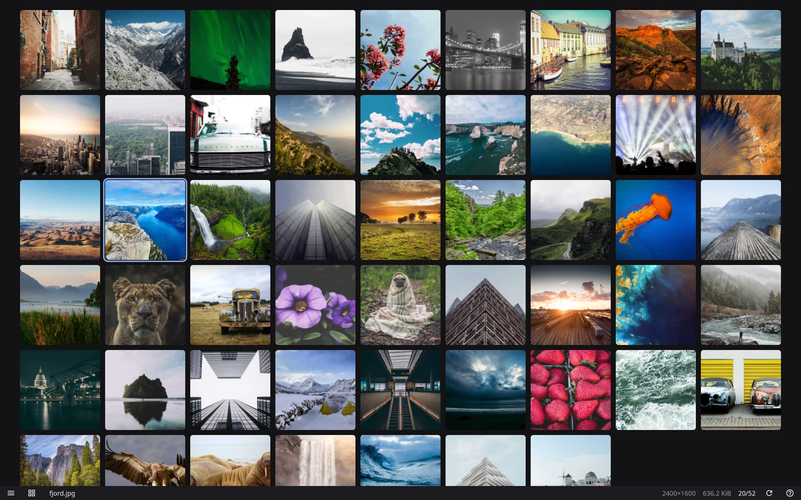
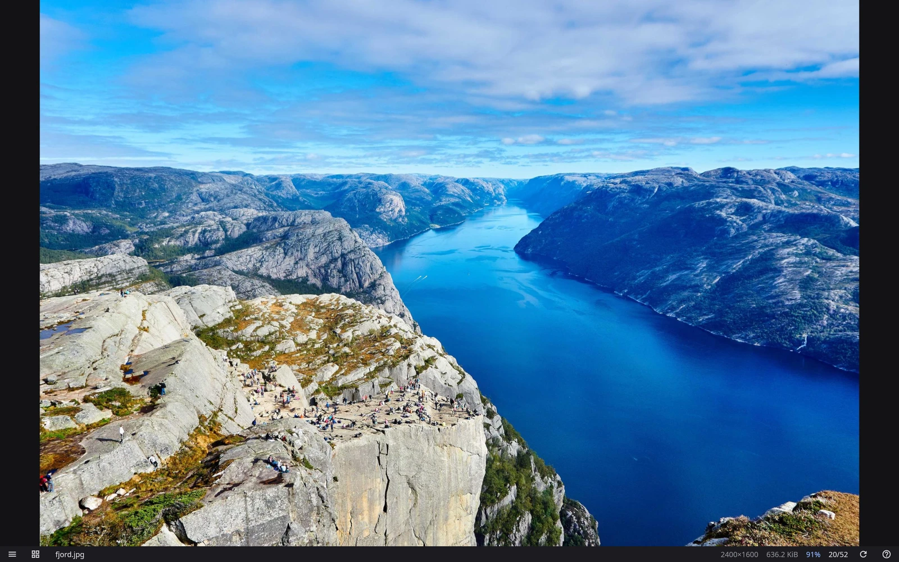
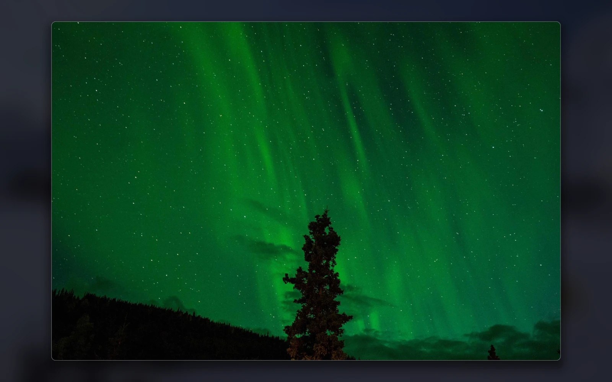
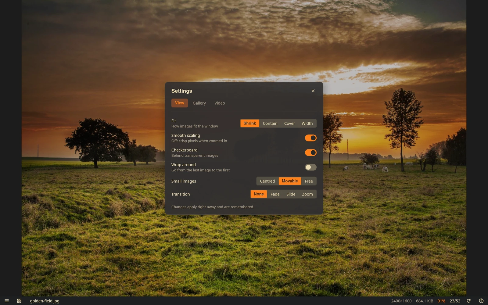
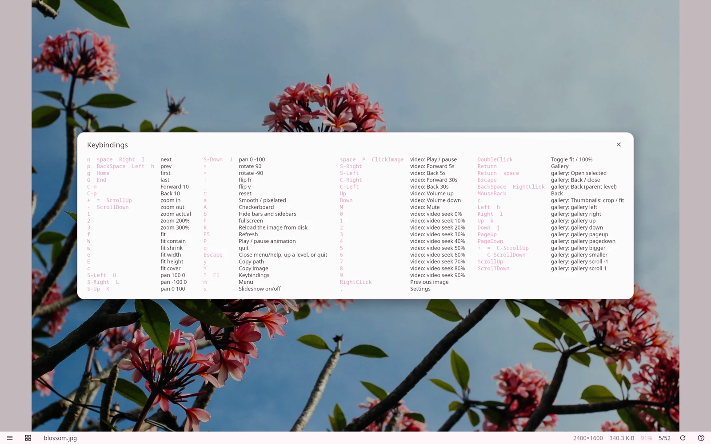
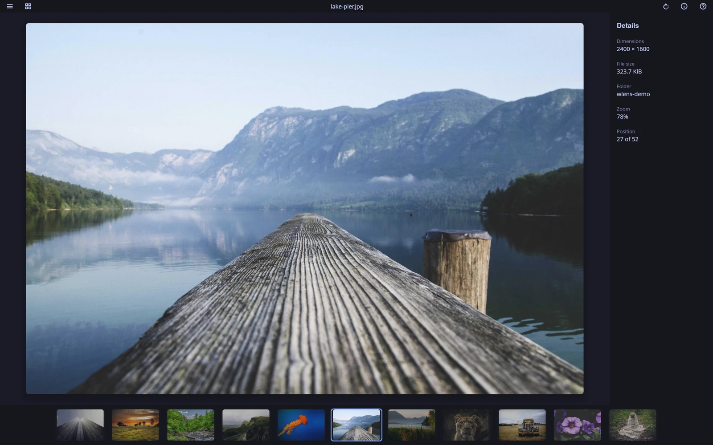
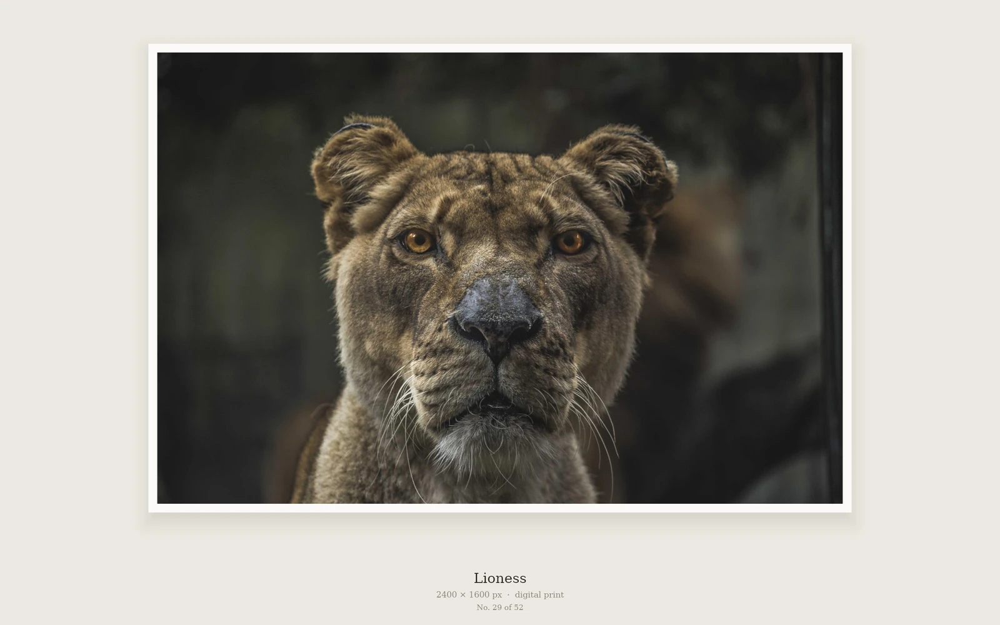

<p align="center">
  
</p>

<h1 align="center">Wayland Lens</h1>

<p align="center">
  <a href="https://github.com/Nynxz/wlens/actions/workflows/ci.yml"></a>
  <a href="LICENSE"></a>
</p>

An image viewer for Wayland, configured and extended with Lua. It renders on
the GPU and can be set up as a plain viewer, a lightbox, a thumbnail gallery or
a folder browser.



- **Viewing:** zoom and pan are GPU-rendered (wgpu). EXIF orientation is
  applied and neighbouring images are preloaded.
- **Galleries:** a thumbnail grid using the shared freedesktop thumbnail cache.
  Folders can be browsed as nested galleries.
- **Animation and video:** animated GIF, WebP and APNG play. Video (WebM, MP4,
  MKV and others, local or streamed) is supported through GStreamer, with
  seeking and volume.
- **Themes:** three presets (`minimal`, `simple`, `lightbox`), each usable with
  any colour palette. Colours, radii and fonts are all configurable.
- **Lua:** keybindings, options, the on-screen UI and image sources are all
  defined in Lua. The built-in defaults use the same API
  ([`src/lua/default.lua`](src/lua/default.lua)).
- **Remote sources:** galleries can load from URLs and web APIs, with paging,
  per-site headers, proxy support and a download cache.
- **Remote control:** `wlens --msg next` drives a running viewer over a Unix
  socket, for compositor keybinds and scripts.

<table>
  <tr>
    <td></td>
    <td></td>
  </tr>
  <tr>
    <td align="center"><sub>The viewer (<code>simple</code> preset)</sub></td>
    <td align="center"><sub>The <code>lightbox</code> preset (<code>--theme lightbox</code>)</sub></td>
  </tr>
  <tr>
    <td></td>
    <td></td>
  </tr>
  <tr>
    <td align="center"><sub>Settings (<code>,</code>) with the <code>gruvbox</code> palette</sub></td>
    <td align="center"><sub>Every keybinding (<code>?</code>) with <code>strawberry-milk</code></sub></td>
  </tr>
</table>

## Getting started

wlens needs Rust 1.96 or newer, and GStreamer with gst-plugins-base for
video. To build without video, add `--no-default-features`. It's developed and
tested on Hyprland, and should work on any Wayland compositor.

```sh
cargo install --git https://github.com/Nynxz/wlens   # or, in a clone: cargo install --path .

wlens ~/Pictures                          # view a folder
wlens -S photo.jpg                        # open one file, browse its folder
wlens --browse ~/Pictures                 # folders as a gallery you can step into
wlens --theme lightbox --palette gruvbox  # pick a look for this run
find ~/pics -name '*.png' | wlens -       # paths (or URLs) from stdin
```

In the viewer:
- `?` shows every keybinding.
- `m` opens the menu.
- `,` opens settings.
- `Return` toggles the gallery.

## Configuring

Configuration lives in `$XDG_CONFIG_HOME/wlens/init.lua`:

```lua
wlens.use("simple", { palette = "tokyo-night", transition = "fade" })

wlens.opt.fit = "shrink"
wlens.opt.wrap = true

wlens.bind("x", "rotate 90")                        -- a command
wlens.bind("C-w", function()                        -- or Lua
  wlens.spawn('swww img "$WLENS_FILE"')
end, "Set as wallpaper")
```

A script can build a gallery from any source, for example a JSON API:

```lua
wlens.on("start", function()
  wlens.fetch("https://example.com/api/photos.json", function(body)
    local items = {}
    for _, p in ipairs(wlens.json.decode(body)) do
      items[#items + 1] = { src = p.url, thumb = p.thumbnail, label = p.title }
    end
    wlens.set_items(items)
  end)
end)
```

The on-screen interface is also defined in Lua. Each of these layouts is a
single config file in [`examples/layouts/`](examples/layouts) (`wlens -c examples/layouts/filmstrip.lua ~/Pictures`):

<table>
  <tr>
    <td></td>
    <td></td>
  </tr>
  <tr>
    <td align="center"><sub><b>Filmstrip</b>: info panel and clickable neighbour thumbnails</sub></td>
    <td align="center"><sub><b>Exhibit</b>: a matted print with a museum caption</sub></td>
  </tr>
</table>

[`examples/scripts/`](examples/scripts) has complete scripts: a ComfyUI
output gallery, a JSON web gallery and an annotated `init.lua`. The built-in
palettes (`gruvbox`, `tokyo-night`, `strawberry-milk`) are in
[`src/lua/palettes/`](src/lua/palettes); copy one to `~/.config/wlens/themes/`
to make your own.

## Documentation

| | |
|---|---|
| [Usage](docs/usage.md) | Running wlens, command-line flags, keys and mouse |
| [Configuration](docs/configuration.md) | `init.lua`, options, keybindings, the command language |
| [Theming](docs/theming.md) | Presets, palettes, every theme property, writing your own |
| [UI and widgets](docs/ui.md) | Bars, buttons, menus and overlays; the widget library |
| [Galleries](docs/galleries.md) | The thumbnail grid, levels (galleries of galleries), folders |
| [Scripting](docs/scripting.md) | The Lua API: items, hooks, timers, HTTP, JSON |
| [Remote sources](docs/remote.md) | URLs, web APIs, proxies, and the example scripts |
| [Development](docs/development.md) | Code layout, design rules, testing |

## License & Credits

wlens is MIT licensed, see [LICENSE](LICENSE).

The photos in the screenshots are from Unsplash; see
[the credits](docs/screenshots/CREDITS.md).
